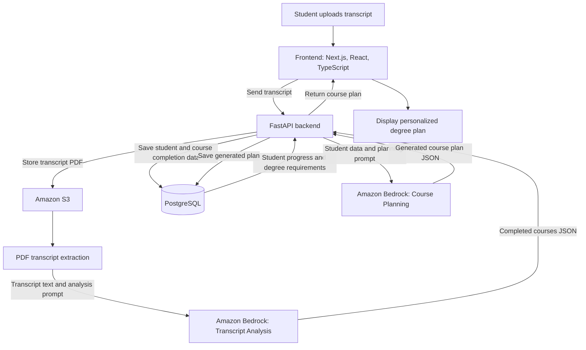

# Aztec Counselor: AI Course Planning Assistant

Aztec Counselor is a full-stack degree-planning application that transforms a student’s transcript and personal constraints into a semester-by-semester graduation plan. It combines Amazon Bedrock’s language-model reasoning with deterministic validation to account for completed courses, prerequisites, degree requirements, unit limits, and individual preferences.

 

## Key Features

- Creates and stores student profiles
- Accepts PDF transcript uploads and stores the original files in Amazon S3
- Extracts transcript text and uses Amazon Bedrock to identify completed courses
- Saves student progress and prevents duplicate completion records when transcripts are re-uploaded
- Generates personalized semester-by-semester plans based on graduation requirements and student constraints
- Evaluates plans using deterministic rules for prerequisites, completed courses, requirement coverage, duplicate courses, and unit limits
- Automatically asks the model to repair plans that fail validation
- Saves generated plans and allows students to retrieve their latest plan
- Displays plans, evaluation results, warnings, and advisor notes through a responsive Next.js interface

## Tech Stack

### Frontend

- **Next.js**
- **React**
- **TypeScript**
- **CSS**

The frontend provides the student-profile, transcript-upload, and degree-planning interface. It displays generated plans by semester along with evaluation results, warnings, and advisor notes.

### Backend

- **FastAPI**
- **Python**

The backend handles student, transcript, course, and plan API requests. It coordinates transcript extraction, AI processing, plan validation, database operations, and communication with the Next.js frontend.

### Database

- **PostgreSQL**

PostgreSQL stores student profiles, course catalog information, graduation requirements, completed courses, generated plans, and evaluation results.

### File Processing and Storage

- **pdfplumber**
- **Amazon S3**

Uploaded transcripts are stored in Amazon S3, while pdfplumber extracts the transcript text for analysis.

### AI Service

- **Amazon Bedrock**
- **Amazon Nova Lite**

Amazon Bedrock converts unstructured transcript text into structured course data and generates personalized degree plans. If the deterministic evaluator identifies errors, the model receives a repair prompt and produces a corrected plan.

### Validation Engine

- **Python rule-based evaluation**

The deterministic evaluator checks prerequisites, duplicate or previously completed courses, graduation-requirement coverage, and semester unit limits. This ensures that plan validation does not rely solely on the language model.

## System Architecture

